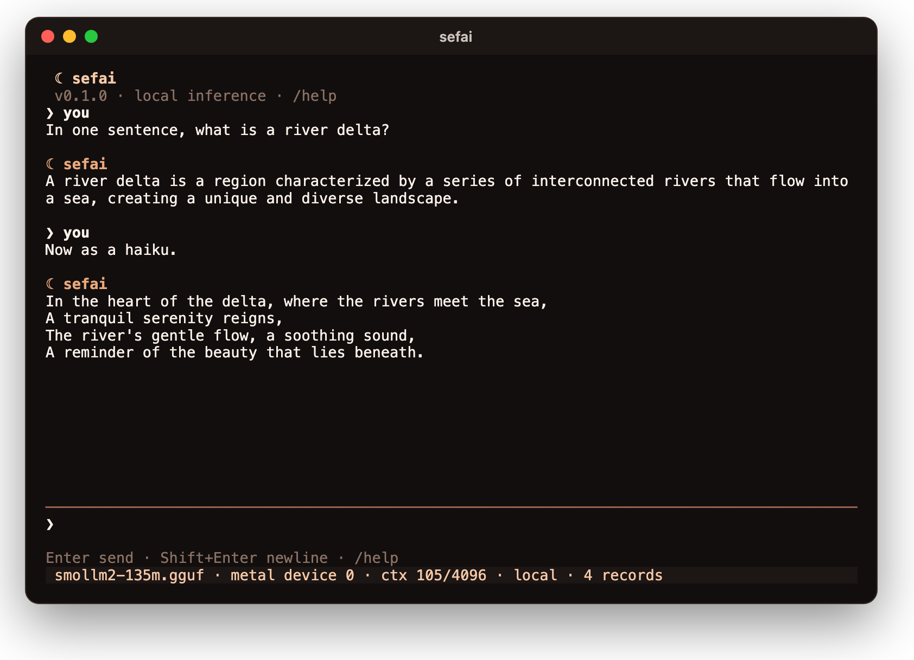

<div align="center">

# ☾ sefai

**A small local LLM runner that lives in your terminal.**

One model stays loaded beside your other apps, and a persistent conversation drives it.
Prompts, skills, memory and sessions are Markdown files you can edit, and every tool call waits for your exact approval.
Nothing leaves the machine unless you connect a server or confirm a download.

[](https://github.com/kanishkpaul/sefai/actions/workflows/ci.yml)
[](https://github.com/kanishkpaul/sefai/actions/workflows/audit.yml)




<sub>A real session, rendered from <a href="docs/media/chat.cast">its recording</a>.
SmolLM2-135M Q4_K_M runs on Metal through llama.cpp; the status line shows the device, the context used and that the turn stayed local.
It is a 135M model, so its idea of a haiku is loose.</sub>

</div>

## At a glance

- **One model, kept loaded, small at rest.** A single worker owns the model and its context, reuses the cache only after checking the actual rendered tokens, and an idle session uses 8.5 MiB.
- **Five formats, each chosen explicitly.** GGUF on CPU or Metal, MLX, GPTQ and AWQ on Apple Silicon, and ONNX on CPU or WebGPU. A failure names its cause; there is never a silent fallback to another backend, a converted checkpoint or a hosted model.
- **Markdown is the settings.** System prompt, preferences, model profiles, skills, memories, sessions and MCP connections are files with strictly typed front matter. Prose never changes a setting or grants a permission.
- **Tools ask, once, exactly.** Each proposed call shows its server, tool, destination and arguments. `y` approves that one call; Enter, `n` and Esc deny.
- **Measured in the open.** 347 tests, a safety checklist that maps every trust boundary to its test, and phase-by-phase evidence with the failures kept.

## How a turn works

```text
  you type ──▶ TUI thread: input and rendering only, never inference or disk I/O
                 │  one-slot command channel · 64-slot event channel
  worker ── composes system.md, preferences, selected skills and recalled memory under a budget
    │
  engine ── renders the model's own template, checks context and output capacity,
    │         reuses only the verified token prefix, streams sanitized text
    │
  a tool proposal? ──▶ validated against the runtime-owned tool list
    │                    ──▶ approval: exact server · tool · arguments, deny by default
    │                    ──▶ dispatched once, result returned as untrusted data
    │
  the turn and every dispatch are saved atomically as Markdown, completed or interrupted
```

Every step has a named limit: 8 generations, 4 tool attempts and 120 seconds per turn, one pending approval, and 16 KiB per tool result.

## Quick start

Each tagged release drafts one archive per platform with SHA-256 sums; until the first release is published, build from source.
Install stable Rust, CMake, a C/C++ compiler and libclang, then:

```sh
git clone https://github.com/kanishkpaul/sefai && cd sefai
cargo build --locked --release -p sefai --features metal,mlx,download   # Apple Silicon
cargo build --locked --release -p sefai --features onnx,download        # Linux, Windows
./target/release/sefai chat
```

The first `chat` creates the Markdown workspace in your configuration directory.
Inside the conversation:

```text
/setup                    what this machine and build can run
/setup recommend          up to three pinned models that fit, with memory estimates
/setup get ID confirm     download, verify against pinned SHA-256s, and write models/ID.md
/profile ID               load it
```

To use a model you already have, run `sefai setup import ID PATH --format gguf` (or `mlx`, `gptq`, `awq`, `onnx`).
[install.md](docs/install.md) covers archives, unsigned-binary warnings, updating and uninstalling: delete the directory, and your Markdown stays until you remove it.

## What runs where

| Platform | Qualified engines | Evidence |
| --- | --- | --- |
| macOS on Apple Silicon | GGUF on CPU and Metal, MLX, GPTQ and AWQ on MLX, ONNX on CPU and WebGPU | Local Apple M5 tests, lifecycle contract and measurements |
| Linux x86_64 and arm64, macOS on Intel, Windows x86_64 | GGUF on CPU; ONNX on CPU except Intel macOS | Hosted CI: lifecycle contract, footprint, clean install |
| NVIDIA and AMD GPUs | None; CUDA and Vulkan compile only | Follow-up gate for contributors with the hardware |

Support depends on the architecture, quantization and export, not just the file format; the [stack](docs/stack.md) and each engine's guide name the qualified model sets.

| Build feature | Adds | Guide |
| --- | --- | --- |
| default (`gguf`) | llama.cpp on CPU and the TUI | [runner.md](docs/runner.md) |
| `metal` | GGUF on Apple GPUs | [runner.md](docs/runner.md) |
| `mlx` | MLX bundles, plus GPTQ and AWQ repacked in memory | [mlx.md](docs/mlx.md), [gptq-awq.md](docs/gptq-awq.md) |
| `onnx`, `onnx-webgpu` | ONNX Runtime on CPU, or WebGPU on Apple Silicon | [onnx.md](docs/onnx.md) |
| `mcp`, `mcp-http`, `mcp-oauth` | MCP over stdio, Streamable HTTP, and OAuth | [mcp.md](docs/mcp.md) |
| `download` | Verified model downloads from the pinned catalog | [setup.md](docs/setup.md) |

## In the conversation

| Input | Does |
| --- | --- |
| Enter · Shift+Enter · paste | Send · newline · insert multiline text without sending |
| Esc · Ctrl+C | Close the overlay or stop generation · stop, or quit when idle |
| PageUp / PageDown · End | Read history without following new tokens · follow again |
| `/model PATH` · `/profile ID` | Choose weights directly, or a Markdown profile |
| `/new` · `/sessions` · `/resume ID` | Start, list and reopen saved sessions |
| `/skill ID` · `/memory ID` · `/recall TEXT` | Toggle a skill, inspect a memory, select literal recall |
| `/setup …` · `/stats` · `/settings` | Hardware and models · token counts, timings and cache reuse · current selections |
| `/mcp` · `/disconnect` | Show or close the MCP connection |
| `y` / `n` | Approve the shown call once / deny it; Enter and Esc also deny |
| Ctrl+K · `/help` · Ctrl+D | Commands · help · quit |

`chat --plain` runs the same conversation line by line, for pipes and basic terminals; `NO_COLOR` and `SEFAI_THEME=light|dark` are respected.
The [terminal guide](docs/tui.md) has every control and limit.

## Customize with Markdown

```text
workspace/
├── config.md           the default model profile and runner settings
├── system.md           system instructions
├── preferences.md      how you like answers
├── models/ID.md        weights path, format, backend, context, output, threads
├── skills/ID/SKILL.md  instructions you toggle per conversation
├── memory/ID.md        recallable notes, with their source
├── sessions/ID.md      every turn, completed or interrupted
├── mcp/ID.md           a server definition; never an approval
└── catalog/ID.md       pinned models setup can recommend and download
```

```markdown
---
schema: 1
id: small
path: /models/smollm2-135m.gguf
format: gguf
runner:
  backend: metal
  device: 0
  context: 4096
---
Notes about this model are prose and never change a setting.
```

Writes are atomic, take an OS file lock and check the exact revision, so an edit you make in another editor is never overwritten.
An invalid edit blocks the next request with the file and field named, and keeps the model and conversation loaded.
`sefai workspace remember`, `edit` and `forget` change memories from the shell; the [workspace guide](docs/workspace.md) documents schema 1, precedence and limits.

## What stops it

| Check | Decides from | Then |
| --- | --- | --- |
| Tool list | the runtime, never Markdown, tool results or the model | two local memory tools, plus the selected MCP server's frozen catalog |
| Approval | the exact call, consumed once and compared again before dispatch | changed arguments, scope or definition void it; nothing replays |
| Typed-ahead keys | when the overlay appeared | `y` in its first 500 ms is ignored; pasted text cannot approve |
| Role forging | each engine's own special tokens | a `<\|im_start\|>` inside memory, skills or tool output is broken before rendering |
| Credentials | named environment variables and OAuth tokens | refused in arguments and memories, redacted from saved records and previews |
| Workspace paths | canonical paths and every component's metadata | traversal and symlink escapes are refused |
| Terminal | every byte of model, tool and file text | control sequences are stripped, even when split across tokens |
| Network | MCP and downloads only | no redirects for MCP; downloads stay on Hugging Face over HTTPS with pinned hashes |
| Budgets | steps, tokens, tools, bytes and time | the turn stops visibly; a dispatched write that cannot be confirmed ends `unknown`, never retried |

### Threat model

sefai reads text it did not write, model output, memories, skills and server responses, while it can write files and call tools.
It does not try to detect prompt injection; it limits what injected text can reach:

- The tool list and every permission come from the runtime and your approval, never from text.
- One exact call is approved at a time; there is no always-allow grant.
- Model-written memories are saved with `source: model` and recalled under an untrusted label.
- Every dispatch intent and outcome is a separate Markdown audit record that never becomes a model message.

Out of scope: hostile model files, which native inference libraries read unsandboxed, and MCP servers you launch, which run with your privileges.
The [safety checklist](docs/safety.md) maps each abuse case to its control and test, and lists the residual risks.

## Measured

| On an Apple M5 MacBook Air | Result |
| --- | --- |
| Idle terminal session, GGUF build | 8.5 MiB resident (target 40 MiB) |
| Idle terminal session, MCP build | 9.0 MiB resident (target 60 MiB) |
| SmolLM2-135M Q4_K_M, CPU, 4 threads | 1,020 tok/s prefill, 358 tok/s decode, 226 MiB peak |
| SmolLM2-135M Q4_K_M, Metal | 18,897 tok/s prefill, 348 tok/s decode, 189 MiB peak |
| Qwen3-0.6B GPTQ Int8 on MLX | 2,541 tok/s prefill, 84 tok/s decode, 1,258 MiB peak |
| Release binary, GGUF only · everything | 11.8 MB · 60.6 MB |

Reproduce any row with [`scripts/measure_footprint.py`](scripts/measure_footprint.py) and the commands in [footprint.md](docs/footprint.md), which also holds the hosted-runner results, sweeps and limits.
One machine and small fixtures: a measured footprint, not a benchmark of model quality.

### What it will not claim

- **NVIDIA and AMD.** CUDA and Vulkan compile in CI but have never run on that hardware, so no archive ships them.
- **Physical Windows and Linux terminals.** CI exercises the plain interface and the lifecycle there; nobody has used the full-screen TUI on those systems.
- **Tool reliability.** Tool use is qualified with SmolLM2-1.7B's text protocol; other models and multi-tool planning are not.
- **Live redaction.** A credential streaming in a reply is shown on screen, because a value can split across tokens; the saved record is redacted.
- **Signed binaries.** Archives are unsigned, because the project has no signing certificates.

[testing.md](docs/testing.md#known-limits) keeps the full list, and each limit blocks only the claim it names.

## How it was checked

- **Traced coverage.** Every command, module, file schema and integration maps to the tests that exercise it and the hardware they ran on ([testing.md](docs/testing.md)).
- **Real models in dedicated targets.** Unit tests need no model or network; engine, lifecycle and harness targets fail when their pinned fixture is missing, instead of skipping.
- **Red team at the trust boundaries.** Forged roles, replayed approvals, symlink escapes, hostile GGUF and safetensors files, terminal escapes and MCP redirects, each with a regression test ([safety.md](docs/safety.md)).
- **Failures kept.** [verification.md](docs/verification.md) records each phase's evidence, including what failed and how it was fixed.
- **CI on Linux, macOS and Windows** runs formatting, Clippy for every feature combination and the tests on every pull request and push to main; the footprint and release workflows cover all five platform targets, including a clean install from each archive, and `cargo deny` audits dependencies on every pull request and weekly.

## Architecture

```text
crates/sefai ─── the binary: commands, composition and terminal lifecycle
   ├─ tui/        input and rendering; one worker owns the model, context and workspace
   ├─ harness/    bounded turns, approvals, redaction, dispatch records
   ├─ workspace/  schema-1 Markdown, bounded reads, atomic revision-checked writes
   ├─ setup/      hardware snapshot, memory estimates, pinned catalog, verified downloads
   ├─ mcp/        stdio, Streamable HTTP and OAuth; never approves its own calls
   └─ term/       sanitization of everything that reaches the terminal
crates/core ─────── messages, prompts and bounded settings; no dependencies, no I/O
crates/engine-llama ── GGUF through llama.cpp, pinned exactly: CPU, Metal
crates/engine-mlx ──── MLX bundles; GPTQ and AWQ admitted and repacked in memory
crates/engine-onnx ─── ONNX Runtime decoder exports: CPU, WebGPU
```

Only the binary composes concrete engines, and each engine is an optional crate, so a GGUF build carries no MLX or ONNX runtime.
No crate in the workspace contains `unsafe`; native code stays behind the binding crates. See [ARCHITECTURE.md](ARCHITECTURE.md) for ownership and invariants.

### Design decisions

| Decision | Why | Rejected |
| --- | --- | --- |
| A terminal app is the permanent home | It runs beside your other apps at a few MiB | Desktop and tray apps, now retired |
| One loaded model, owned by one worker | Predictable memory and no contention for the context | Several resident models or a speculative second one |
| Markdown is canonical | You can read, edit, diff and back it up | A hidden database or binary settings store |
| Reuse the cache only on a verified token prefix | Sampled output need not match the next rendered prompt | Assuming the transcript re-tokenizes the same way |
| One exact approval per call; Enter denies | A model or server cannot talk its way into authority | Always-allow grants and keyword lists of risky tools |
| Name every failure; never fall back | You always know which engine and device ran | Automatic CPU, hosted or converted-checkpoint fallback |
| Engines as optional crates, no plugin layer | Two similar adapters cost less than one wrong abstraction | A generic engine registry before a second backend existed |

## Commands

| Command | Does |
| --- | --- |
| `sefai` · `sefai chat` | The terminal conversation; `--plain` for line mode, `--tool-protocol smollm2` for tools, `--mcp ID` to connect |
| `sefai run --model PATH "prompt"` | One generation to stdout, with device and context on stderr |
| `sefai bench --model PATH "prompt"` | Load, prefill and decode timings |
| `sefai devices` | The local inference devices this build can use |
| `sefai setup hardware\|check\|recommend\|catalog\|get\|import` | Hardware, fit estimates, the pinned catalog and verified downloads |
| `sefai workspace init\|check\|remember\|edit\|forget\|tail` | Create, validate and edit the Markdown workspace |
| `sefai prompt TEXT` | Print the composed prompt without loading a model |
| `sefai mcp ID inspect\|read\|prompt` | List a server's catalog, read a resource or render a prompt, after a `y` (`mcp` build) |

## Documents

| | |
| --- | --- |
| [Install](docs/install.md) | Archives, first run, update, uninstall, building from source |
| [Model setup](docs/setup.md) | Hardware check, estimates, catalog, downloads and imports |
| [Terminal](docs/tui.md) | Controls, overlays, ownership and limits |
| [Runner](docs/runner.md) | Commands, engine selection and the lifecycle contract |
| [Harness](docs/harness.md) | Tool protocol, approvals, budgets and recovery |
| [MCP](docs/mcp.md) | Connections, transports, OAuth and what a connection may do |
| [Workspace](docs/workspace.md) | Schema 1, precedence, limits and atomic writes |
| [Safety](docs/safety.md) | Every trust boundary, its control, its test and residual risks |
| [Footprint](docs/footprint.md) | Memory, throughput and the platform matrix |
| [Testing](docs/testing.md) | Coverage, red team, dependency audit and known limits |
| [Build plan](docs/build-plan.md) · [Verification](docs/verification.md) | The fourteen phases, their gates and their evidence |
| [Architecture](ARCHITECTURE.md) · [Style](docs/style.md) | Crates, invariants, and how code here is written |

## Contributing

Read [AGENTS.md](AGENTS.md), [docs/style.md](docs/style.md) and [ARCHITECTURE.md](ARCHITECTURE.md) first.
Run `cargo fmt`, both Clippy builds and `cargo test --locked --workspace` before each commit, add the test that would have caught a bug alongside its fix, and read [docs/safety.md](docs/safety.md) before touching approvals, credentials, MCP, workspace writes or downloads.
[CONTRIBUTING.md](CONTRIBUTING.md) has setup and the publication policy.

## Related work

- [llama.cpp](https://github.com/ggml-org/llama.cpp), [MLX](https://github.com/ml-explore/mlx) and [ONNX Runtime](https://github.com/microsoft/onnxruntime): the inference engines sefai embeds.
- [Ollama](https://github.com/ollama/ollama) and [LM Studio](https://lmstudio.ai): local runners that serve models to other apps.
- [Model Context Protocol](https://modelcontextprotocol.io): the tool protocol behind sefai's connections.
- [SmolLM2](https://huggingface.co/HuggingFaceTB/SmolLM2-1.7B-Instruct): the open models behind the fixtures and images above.
- [ChromeClaw](https://github.com/kanishkpaul/chromeclaw) and [Casca](https://github.com/kanishkpaul/casca): agents for the browser and the desktop, from the same design kit.

## Cite

```bibtex
@software{paul2026sefai,
  author = {Kanishk Paul},
  title  = {sefai: a small local LLM runner that lives in your terminal},
  year   = {2026},
  url    = {https://github.com/kanishkpaul/sefai}
}
```

MIT licensed. Release archives include `THIRD_PARTY_NOTICES.txt` with the license of every bundled dependency, including llama.cpp, MLX, ONNX Runtime and Dawn.
